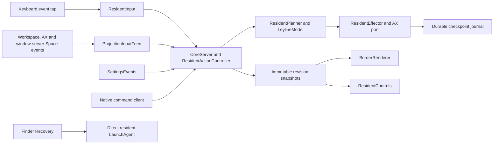

# Native architecture

The installed `Leyline.app` launches one `leylined` resident through the user
LaunchAgent `org.leyline.leylined`. The resident owns input, observation, authority,
planning, journaled effects, settings and AppKit presentation. Finder Recovery is
an independent on-demand client of launchd; CLI clients use the local socket.

## Ownership

| Module | Responsibility |
|---|---|
| `LeylineModel` | Pure arrangement, allocation, navigation, mode FSM and evidence values |
| `CoreServer` | Serial authoritative revisions and local command transport |
| `ResidentActionController` | Admission, context fencing, journal ordering and effect coordination |
| `ResidentPlanner` / `ResidentPlannerLayout` | Deterministic lifecycle, focus, resize and move plans |
| `ResidentSpacePartitions` | Conserved arrangements for identifiable enabled visible Spaces |
| `ProjectionInputFeed` / `TargetedProjectionSnapshot` | Versioned Workspace/AX observation and trustworthy Space membership |
| `AccessibilityFocusObserver` / `AccessibilityWorldObserver` | AX focus and window-lifecycle notifications feeding observation |
| `CoreWindowSpaceNotifications` | Window-server reports of a window joining or leaving a Space, such as a Mission Control move |
| `ResidentInput` / routing | One keyboard tap, native claims, sticky modes and independent safety release |
| `ResidentInputFault*` | Safety-release evidence and the short keyboard-release notice |
| `ResidentEffector` / AX port | Bounded compound writes (with an app's `AXEnhancedUserInterface` suspended during them) and identity-bound landed verification |
| `CoreRuntimeServices` / `SettingsEvents` | Lifecycle, readiness and settings/border-file changes |
| `ResidentMaintenance` | Exclusive soft/hard reset epochs with stop acknowledgements |
| `ResidentInstallation` | Per-user LaunchAgent install, update, removal and service control |
| `BorderProjection` / `BorderRenderer` | Read-only role/ghost plans and pooled noninteractive panels |
| `ResidentControls` / `ResidentStatusIcon` | Mouse-reachable menu, focused-Space status icon, frozen targets and typed control intents |

Only the pure model is platform independent. AX reads and AppKit presentation are
outside the ordered authority/input callback. Async work returns original context
and generation; stale completion cannot overwrite a later revision. Rendering
coalesces visual snapshots without dropping input/effect transitions.

Production resources are packaged beside the resident: keymap/decode, version and
native CLI commands. Border defaults are compiled into `BorderPalette`. Fixtures
and self-test harnesses belong to the developer build, not the installed
production resident. See
[development](../development.md) for build boundaries.

The user-data root stores durable settings and the authoritative journal separately
from immutable app resources. The command socket is local and user-scoped. App
updates retain user state; recovery never edits it. See [privacy](../privacy.md).

Observation, plan, commit, attempted effect, verified readback, AppKit submission
and physical visibility are distinct [evidence boundaries](../model-layout-correspondence.md).
The architecture does not certify physical timing or every macOS Space scenario.
